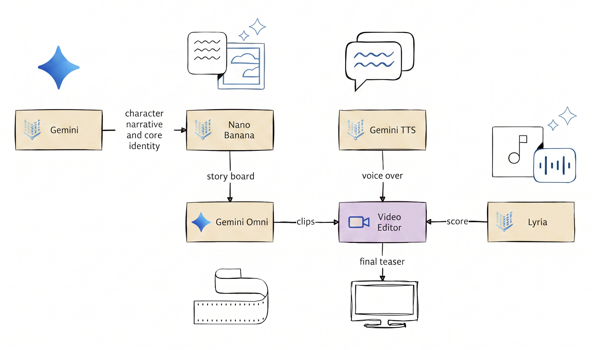

# The Birth of a New Krapopolis Citizen: From Concept to Creation with GenMedia

## Introduction

Welcome to the future of animation! In this workshop, you will take on the role of a member of the creative team for the animated series Krapopolis. Your mission is to create a compelling 45- 60  second teaser for a new character for the show. 

This isn’t about writing code. It’s about mastering the art of the prompt. You will use Google Cloud’s generative AI tools within Agent Platform Studio to bring your vision to life. The challenge lies in guiding these models to produce a final teaser that is not just aesthetically pleasing, but also coherent, consistent, and on-brand, complete with multilingual voice-over, graphic overlays and a custom soundtrack.

## Learning Objectives

This hack will help you master the following skills:

- Advanced Prompt Engineering  
  - Crafting detailed prompts to control style, composition, and object consistency.  
- Consistent Generation  
  - Creating a believable product and protagonist and maintaining their appearance across different shots.  
- Text-to-Image Generation  
  - Composing a set of graphical elements to enhance visual appeal and convey brand information.
- Text-to-Video Generation  
  - Directing AI to create dynamic, high-quality video clips from text and image prompts.  
- Text-to-Speech Generation  
  - Creating a professional voice-over in multiple languages.  
- Text-to-Music Generation
  - Composing a custom soundtrack that matches the mood of the ad.  
- Video Assembly  
  - Stitching generated visual and audio assets into a final, polished video.

## Challenges

- Challenge 1: From Idea to Character Narrative  
- Challenge 2: The Visual Blueprint  
- Challenge 3: From Stills to Motion  
- Challenge 4: The Assembly  
- Challenge 5: Giving It a Voice  
- Challenge 6: The Soundtrack  

## Prerequisites

- Basic understanding of generative AI concepts (text-to-image, text-to-video, text-to-speech).  
- Access to a Google Cloud project with Agent Platform Studio enabled, including access to Gemini, Omni, Gemini TTS, and Lyria models.  
- Access to a basic video editing tool (e.g., Google Vids, DaVinci Resolve, Adobe Premiere Pro, CapCut, iMovie, or any online editor).

## Contributors

- Kishen Gopinath
- Gino Filicetti  
- Murat Eken  
- Jeff Katzen  
- Justin Grayston

## Challenge 1: From Idea to Character Narrative

### Introduction

Every animated show has compelling characters that contribute meaningfully to the story arc. In this challenge we’ll introduce a new character and come up with guidelines for the character, design a backstory for them while making sure everything stays coherent.

#### The Character

Introduce a new character to the TV series Krapopolis. 

Context: The series revolves around Tyrannis, a mortal king who attempts to build, civilize, and govern the fledgling city of "Krapopolis". Unlike the legendary, idealized cities of Greek myth, Krapopolis is a messy, chaotic prototype of civilization. Tyrannis constantly struggles to establish order, democracy, and basic infrastructure, a task made near-impossible by his chaotic, destructive family of deities and beasts who reside in his palace.

> [!NOTE]  
> This challenge is all about building our story and characters, we’re expecting you to craft descriptions, which we’ll use in the subsequent challenges to create prompts. So, your descriptions should be detailed enough to capture the essence of your story, but keep in mind that we’re not designing prompts yet.

### Description

First, create a document (e.g. Google Doc) that’s shared with your whole team, so you can collaborate and keep track of your work.

Then, start by designing the Core Identity for the character, these should include:

- Character Name: [Insert Name]
- Animation Style: [e.g., 3D Pixar style, 2D cyberpunk anime, stop-motion claymation, vintage 90s cartoon]
- Core Vibe/Keywords: [e.g., mysterious and brooding, hyperactive and colorful, clumsy but brilliant]
- Key Visual Features: [e.g., glowing green eyes, wears an oversized red bomber jacket, carries a giant wrench]

These characteristics will guide all the visuals we create for the product.

Next, create a description of your character. This description needs to be detailed enough so that we can achieve consistency from shot to shot in the ad.

Now, we’ll craft an overall narrative to tell the story of the character and what makes them compelling. We will do this by creating textual descriptions of at least three scenes for a teaser describing what happens in each scene and how the character fits into the overall Krapopolis premise.

And finally, create a stinger and title for the character that leaves a lasting impression. We’ll use that text in our final ad video.

> [!NOTE]  
> Using Gemini in this challenge is fair game, but if you want to flex your creative muscles and do your own writing, please feel free to.

### Success Criteria

- You have created a core identity for the character with the attributes: Character Name, Animation Style, Core Vibe/Keywords, Key Visual Features
- You have created a detailed narrative of the character.
- You have created a text description/script for at least three scenes that introduce the character into the show.
- You have created a stinger and title for the character that leaves a lasting impression. 
- Your work is stored in a shared document (e.g. Google Doc) that’s accessible by your team.

### Learning Resources

- [Gemini Prompts for Ad Copy](https://felloai.com/2025/08/7-effective-gemini-prompts-for-ad-copy-that-actually-bring-results/)
- [Storytelling in the Ad Creative Process](https://mailchimp.com/resources/storytelling-in-marketing)  

### Tips

- Focus on your story and keep in mind that you have 45-60 seconds to tell that story.
- Don’t try to squeeze too many different things in a single scene.
- Using Gemini is fair game, but make sure that you keep its output brief and clear.
- Although Gemini will help with inspiration, it will generate similar (and rather bland) ideas if you enter the challenge description in verbatim (we’ve seen far too often an architect called Elara to be the protagonist)
 
## Challenge 2: The Visual Blueprint

### Introduction

Now that we have our character's core identity and narrative, it’s time to create our visuals. This is the storyboard of your ad, which visually shows the flow of your narrative and your character within it.

### Description

We will now create our character. Using Gemini Native Image (aka: Nano Banana), generate a representative image of your character using your description of them and their core identity. 

Once you have your character's images, generate more images that depict the character at different angles (front, side, back, 3/4, etc).

> [!NOTE]  
> Given the image limit as context when generating videos and images, consider creating a “contact sheet” for the character with all images at the various angles together in one image file

Next, create images for your storyboard visualizing the scenes crafted in the previous challenge. These storyboard images should contain accurate and consistent depictions of the character when they are shown.

> [!NOTE]  
> These storyboard images will be used in the next challenge and there are multiple ways to reference them. You can use them as start/end frames, you can use them as Subject reference. If you don’t design your storyboard images with that idea or if you don’t use them in the next challenge, you will struggle with the consistency.

> [!IMPORTANT]  
> The storyboard images must be in 16:9 format because we’ll use them as references for the video clips we’ll create in the next challenge

We’ve already created a storage bucket for you, make sure that all of this work is stored in that bucket, as we’ll use these assets when we compose our final video (copying those images into your document and screenshotting will negatively impact the quality of these images).

### Success Criteria

- Multiple consistent images are generated that clearly define the character’s appearance from various angles.
- You have generated distinct storyboard images.
- The character’s appearance is visibly consistent across all storyboard images.
- The overall aesthetic, mood and color palette is consistent
- Your coach approves of the visual consistency of your images.
- The images are stored in the storage bucket that has been provided to you.

### Learning Resources

- [Agent Platform Studio Quickstart](https://docs.cloud.google.com/gemini-enterprise-agent-platform/agent-studio/quickstart)
- [Nano Banana Prompting Guide](https://developers.googleblog.com/en/how-to-prompt-gemini-2-5-flash-image-generation-for-the-best-results/)

### Tips

- If you’re in a squeeze for time, you can parallelize some tasks like image generation , and getting prompts ready for voice-over and the score . 
- Keep in mind that some models will have limitations with respect to how many reference images you can include in a prompt and the maximum size. See for example the Technical Specifications for Nano Banana 2
- There are also limits in the Studio UI, you might want to use the Import from Cloud Storage options instead of uploading your images in your prompt

## Challenge 3: From Stills to Motion

### Introduction

With your storyboard and character  created, it’s time to bring your vision to life. This challenge is about converting your static scenes into dynamic video clips.

### Description

Using the Gemini Omni Flash family of models in Agent Platform Studio, generate video clips for each of your storyboard scenes from Challenge 2. Make sure you use your generated images as references in your prompts to guide the model.

> [!IMPORTANT]  
> It’s fine to have background sound or noises for some parts of your video, but keep in mind that you’ll be generating voice-overs in a later challenge. Also, if you need to have dialog that syncs with lips on the screen, that needs to be done during video creation time.

Once finished, store your favorite clips for each scene in the storage bucket provided to you (ideally in a separate folder).

### Success Criteria

- High-quality video clips for each of the storyboard scenes are generated.
- The total runtime for the video clips should be around ~45 seconds (min: 30 seconds and max: 1 minute).
- The video aesthetics, mood and color palette are highly consistent with the corresponding static images.
- The motion depicted is smooth and realistic.
- When viewed in sequence, the clips form a coherent narrative, with logical transitions.
- Your coach approves of the visual consistency of your videos and their fidelity to your storyboard images.
- The videos have been stored in the storage bucket that has been provided to you.

### Learning Resources

- [Generate videos with Agent Platform](https://docs.cloud.google.com/gemini-enterprise-agent-platform/models/video/overview)
- [Omni Prompting Guide](https://deepmind.google/models/gemini-omni/prompt-guide/)

### Tips

- Similarly to the previous challenge, if you’re pressed for time, you can parallelize the video generation for the various scenes.

## Challenge 4: The Assembly

### Introduction

You have all your visual components. Now it’s time for post-production. In this challenge, you’ll act as the editor, assembling the generated clips into a single, character teaser.

### Description

Using a video editor of your preference, stitch together the video clips you created in Challenge 3. The goal is to create a single, cohesive video file that flows logically and tells the intended story.

To close out the teaser, add in the character’s name and any other static graphics you created in Challenge 2. Don’t forget to add your punchline  here as well

### Success Criteria

- The video is around 45-60 seconds long (min: 30 seconds and max: 1.25 minutes).
- The video tells a coherent story, using the shots generated in the previous challenge.
- The final assembled video is free of jarring cuts, ridiculous transitions (no star wipes!) or continuity errors.

### Tips

- [Google Vids](http://vids.google.com) is a great and free service for editing videos.

## Challenge 5: Giving It a Voice

### Introduction

A silent film can be powerful, but a voice-over can deliver a targeted message. In this challenge, we’ll generate a set of professional-sounding voice-overs for your teaser.

### Description

First, write a short, compelling script for your teaser. The script should consist of multiple pieces of voice-over audio to be inserted into your ad in different spots. The script should align with the core identity and narrative that you have defined for the character.

> [!NOTE]  
> Once again, Gemini is fair game to generate the script, but you’re also free to use your own writing creativity.

Next, use the Agent Platform Gemini TTS model to generate the voice-overs from your script.

Finally, add these audio tracks to the video you assembled in Challenge 4 in the proper places in your video sequence timeline.

### Success Criteria

- A short script is written describing multiple voice-overs needed in the teaser.
- Multiple high-quality voice-overs are generated.
- The voice-overs are successfully added to the video file, with timing that matches the visuals.

### Learning Resources

- [Prompting tips for Gemini Text to Speech](https://docs.cloud.google.com/text-to-speech/docs/gemini-tts#prompting_tips)

## Challenge 6: The Soundtrack

### Introduction

Music is an important layer of emotion in your teaser. To complete your masterpiece, you will use Google’s Lyria model to compose a custom piece of background music that complements the visuals and voice-over.

### Description

Using the Agent Platform Lyria model, generate a music track for the entire teaser. 

Once you have a track you’re happy with, add it as a final audio layer to your video sequence timeline. Make sure to balance the volume so that the music complements the voice-overs without overpowering them.

### Success Criteria

- A music track is generated for the entire length of the teaser.
- The music’s mood and style align with the character's core vibe.
- The music is successfully added to the video, creating a final, polished ad with visuals, voice-over, and a soundtrack.
- You’ve exported your final ad as an MP4 file.

### Tips

- Keep in mind that Gemini itself can be a helping hand here. If you give it your storyboard it can give you a recommendation for a good soundtrack to use.
- The Lyria model is trained from the point of view of a musician and their instrument. You’ll get better results if your prompt speaks in the language of instruments.
